<p align="center">
  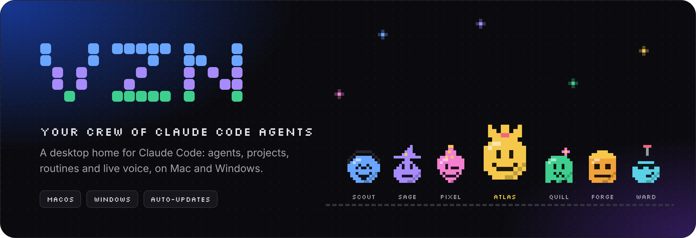
</p>

<p align="center">
  <a href="https://github.com/YuvrajxGarg/vzn/releases/latest"></a>
  <a href="https://github.com/YuvrajxGarg/vzn/releases/latest"></a>
  <br />
  <a href="https://github.com/YuvrajxGarg/vzn/releases"></a>
</p>

<p align="center">
  <b>VZN is a desktop app that turns Claude Code into a crew of agents.</b><br />
  Give each agent a job, a face and a model, hand them tasks, and watch them work side by side,<br />
  in projects with a coordinator, routines that run on a schedule, and a composer you can talk to.
</p>

<p align="center">
  <a href="#install">Install</a> ·
  <a href="#how-it-works">How it works</a> ·
  <a href="#features">Features</a> ·
  <a href="#updates">Updates</a> ·
  <a href="#faq">FAQ</a>
</p>

<br />

<p align="center">
  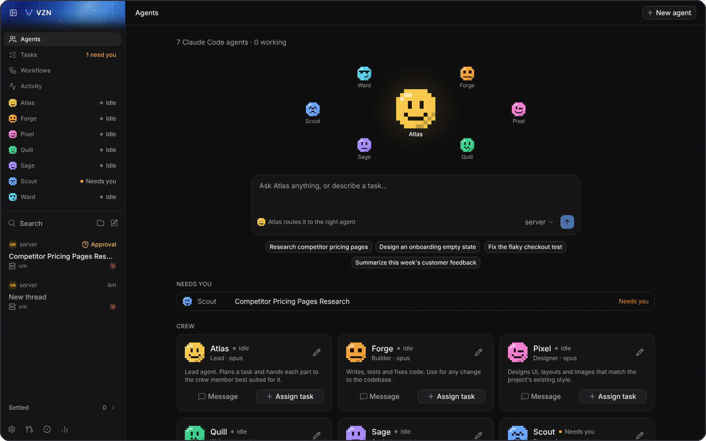
</p>

---

<a id="install"></a>

##  Install

You need **[Claude Code](https://claude.com/product/claude-code)** installed and signed in on the same computer (`claude` in your terminal should work). VZN runs your own Claude Code, with your own plan.

### macOS (Apple silicon)

1. Open the [latest release](https://github.com/YuvrajxGarg/vzn/releases/latest) and download **`VZN-x.y.z-arm64.dmg`**.
2. Open the `.dmg` and drag **VZN** into **Applications**.
3. Open VZN once by hand, as below. VZN is signed with its own certificate rather than an Apple developer ID, so macOS asks you to confirm the first time.

<a id="first-open-on-a-mac"></a>
<details open>
<summary><b>First open on a Mac</b></summary>
<br />

When macOS says VZN *"can't be opened"* or *"Apple could not verify"* it:

1. Click **Done** (or **OK**) on that message.
2. Open **System Settings → Privacy & Security**.
3. Scroll down to the message about VZN and click **Open Anyway**, then enter your password.
4. Click **Open** in the last prompt. From now on VZN opens normally.

On older macOS versions you can instead Control-click **VZN** in Applications, choose **Open**, then **Open** again.

Still blocked? This one-liner does the same thing from Terminal:

```sh
xattr -dr com.apple.quarantine /Applications/VZN.app
```

macOS may also ask for access to **"vzn Safe Storage"** in your keychain after an install or update. That is where VZN keeps its own saved settings. Click **Always Allow**.

</details>

### Windows (x64)

1. Open the [latest release](https://github.com/YuvrajxGarg/vzn/releases/latest) and download **`VZN-x.y.z-x64.exe`**.
2. Run it. If Windows shows *"Windows protected your PC"*, click **More info → Run anyway**. The installer is not code-signed yet, so SmartScreen warns the first time.
3. Start VZN from the Start menu.

### First launch

VZN finds your `claude` install and checks that you are signed in. Open **Agents** and add the starter crew of seven (or your agents from `~/.claude/agents` show up on their own), add a folder or a GitHub repo as a project, and start talking.

---

<a id="how-it-works"></a>

##  How it works

```
 you ──▶ VZN window ──▶ VZN's local server ──▶ your claude CLI ──▶ Claude
              ▲                 │
              └── live status ◀─┘  threads, tasks, routines, memory in ~/.vzn
```

- **It runs on your computer.** VZN is a desktop window plus a small local server. The server starts the official `claude` command line for every run and streams what it does back to the window, live.
- **It uses your Claude Code, not a copy.** VZN never reads or reuses Claude Code's sign-in token. It starts the real `claude` binary, so your plan, settings, skills, MCP servers and plugins all just work.
- **Agents are plain files.** Every agent is a Claude Code agent file in `~/.claude/agents`. Edit one in VZN and Claude Code sees the change, and the other way round.
- **A task is a thread.** Assign work to an agent and VZN opens a thread for it. A lead agent can split work and hand pieces to the rest of the crew, each in its own thread, and parallel tasks in the same repo get their own git worktree and branch so they never trip over each other.
- **Your data stays local.** Threads, projects, routines and memory live in `~/.vzn` on your machine. Usage analytics are off.

---

<a id="features"></a>

##  Features

### Your crew of agents

A home for every Claude Code agent you have. Each one gets a pixel face, a colour, a role, a model and its own permissions, and you can see at a glance who is idle, working or waiting on you. Ask the lead (Atlas) anything and it routes the job to the right agent, or name an agent in any chat to hand it work.

<table>
  <tr>
    <td width="50%">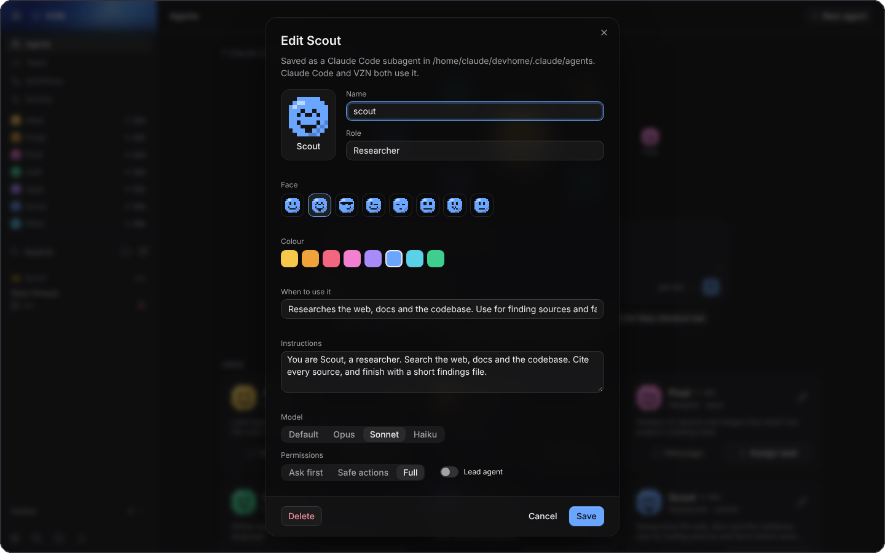</td>
    <td width="50%">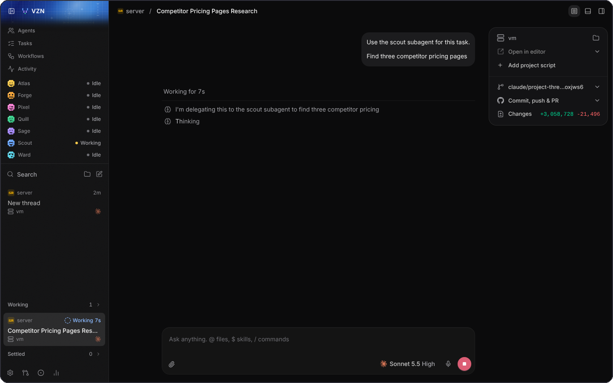</td>
  </tr>
  <tr>
    <td><sub><b>Make them yours.</b> Pick a face, body shape, colour and accessory (crowns, wizard hats, headphones, halos and more), plus model and permissions.</sub></td>
    <td><sub><b>Live status.</b> Every task is a thread you can open, follow and reply to. The sidebar shows each agent's state as it changes: Idle, Working, Needs you.</sub></td>
  </tr>
</table>

### Projects with a coordinator

A project ties together folders, GitHub repos, instructions and memory. Each one has a **coordinator chat**: tell it the goal and it plans the work, opens a thread for each part, and picks an agent and model for it. Threads show up beside the chat with their status, and you can open any of them without leaving the project.

<table>
  <tr>
    <td width="50%">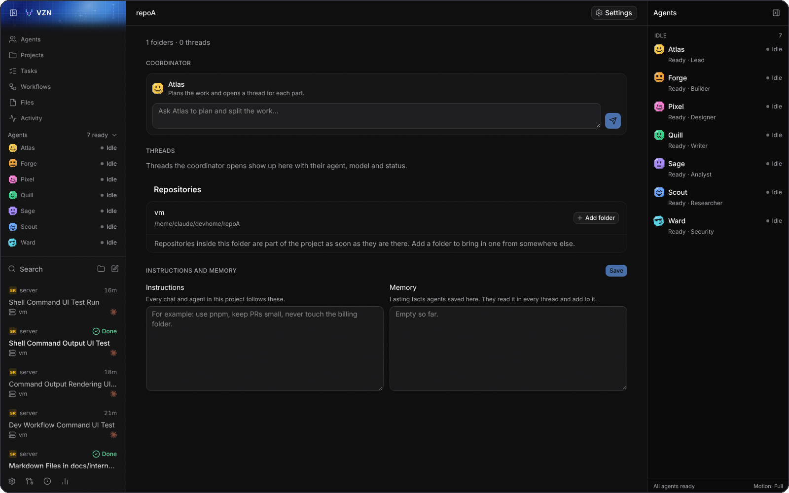</td>
    <td width="50%">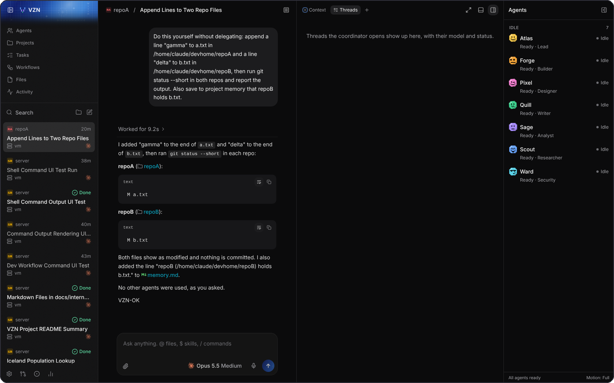</td>
  </tr>
  <tr>
    <td><sub><b>Repos, instructions, memory.</b> Add a folder, or pick one of your GitHub repos and VZN clones it. Instructions apply to every chat in the project, and agents save lasting facts to project memory as they work.</sub></td>
    <td><sub><b>Coordinator + threads.</b> The coordinator splits the work. Each thread runs on its own branch and can push and open a pull request when it is done.</sub></td>
  </tr>
</table>

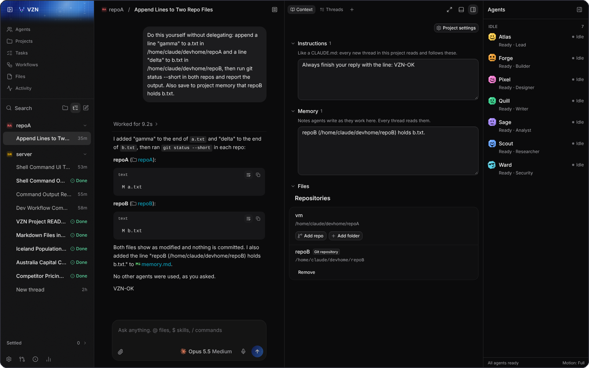
<p align="center"><sub><b>Sidebar grouped by project.</b> Every chat sits under its project, with live Working / Done status, and one click flips back to a flat list.</sub></p>

### Routines, Board and Calendar

Routines are agent jobs on a schedule: an inbox triage every few hours, a security sweep every Monday, a morning briefing on weekdays. Every run becomes a task for that agent, so it shows up everywhere tasks do.

<table>
  <tr>
    <td width="50%">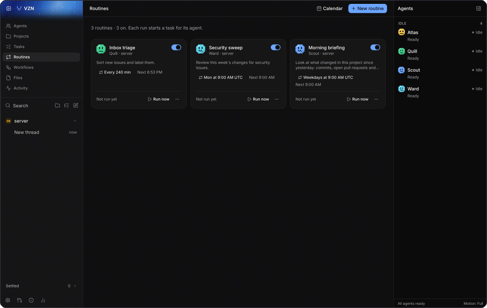</td>
    <td width="50%">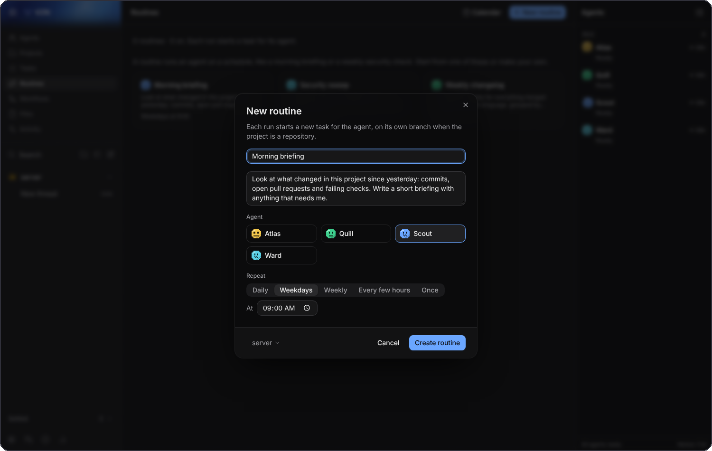</td>
  </tr>
  <tr>
    <td width="50%">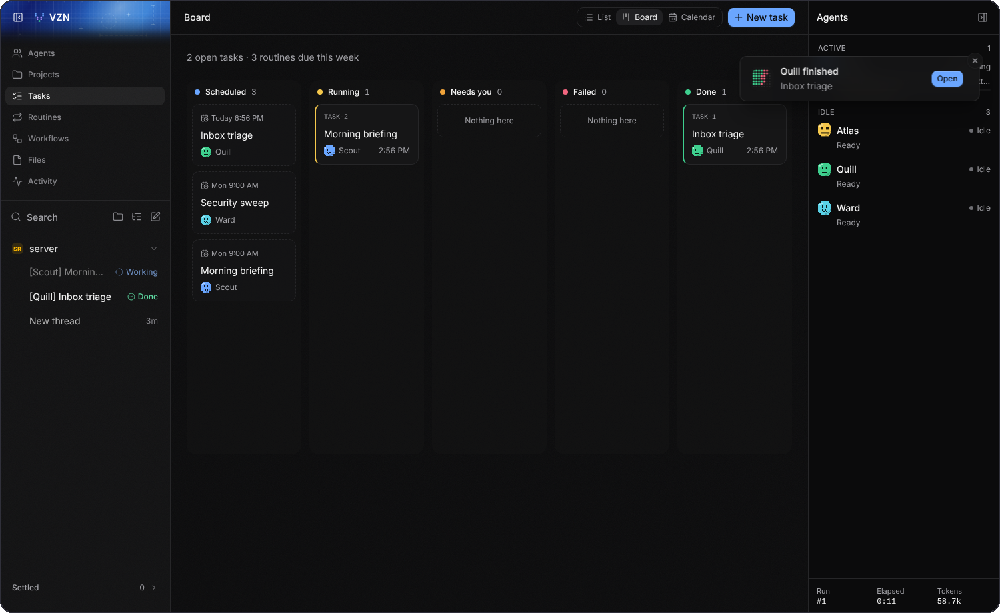</td>
    <td width="50%">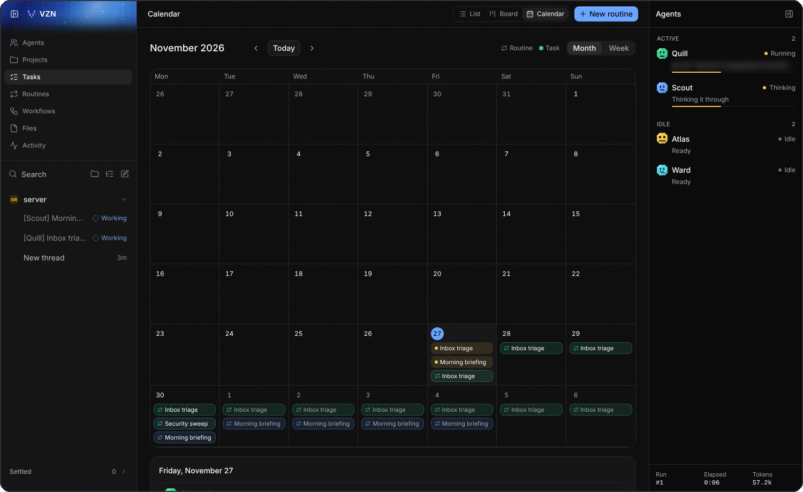</td>
  </tr>
  <tr>
    <td colspan="2"><sub><b>List, Board, Calendar.</b> The board sorts every task into Scheduled, Running, Needs you, Failed and Done. The calendar shows past runs and the ones still to come, by month or week. Hit <b>Run now</b> on any routine to try it straight away.</sub></td>
  </tr>
</table>

### Talk to it: live voice dictation

<p align="center">
  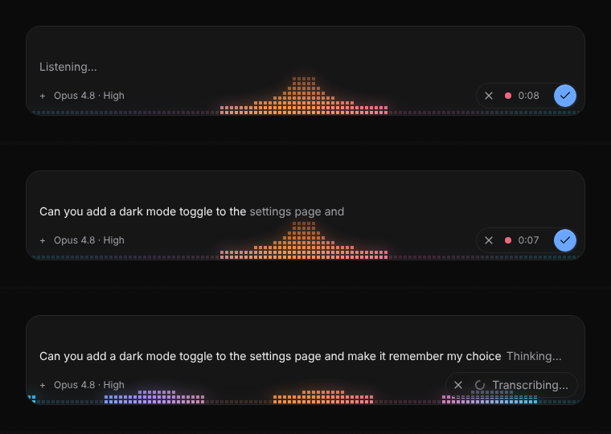
</p>

Hit the mic and the composer lights up with a glowing pixel visualizer that moves with your voice, while your words appear as you say them. Transcription runs **on your computer** with the Parakeet speech model (a one-time ~730 MB download in **Settings → Voice**), so nothing is sent anywhere and no API key is needed.

### Cards for the things that matter

<table>
  <tr>
    <td width="50%">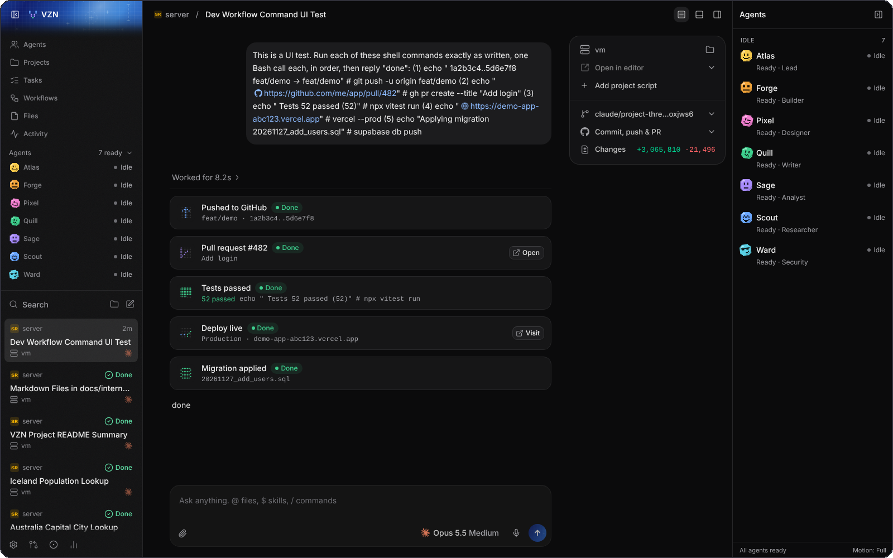</td>
    <td width="50%">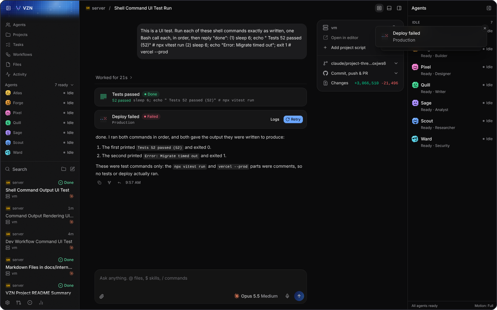</td>
  </tr>
  <tr>
    <td><sub><b>Action cards.</b> Pushes, pull requests, test runs, deploys and database migrations show up as clear cards with links, even when the rest of a run is folded away.</sub></td>
    <td><sub><b>Pixel toasts.</b> When an agent finishes, needs you, or a deploy fails, a small animated toast tells you, with a button to jump straight there.</sub></td>
  </tr>
</table>

### And more

- **Reactions and silent replies.** React to any message with an emoji, and agents can react back. Drop a link for an agent to file away and it can answer with 👀 then ✅ instead of a wall of text.
- **Commands, skills and mentions.** Type `/` for commands, `$` for skills and `@` for files, or name an agent (`@scout find three competitor pricing pages`) to hand it the job.
- **Git built in.** Branch per task, diffs, commit, push and *Create PR* from the thread.
- **Computer use (optional).** Turn it on in **Settings → Devices** and agents can click and type in apps for you, asking before the first action.
- **Usage at a glance.** Threads, models and plan usage per project.

---

<a id="updates"></a>

##  Updates

VZN updates itself. It checks this repository's releases in the background, downloads a new version when there is one, and shows an **Update** button in the sidebar. Click it to restart into the new version. You only ever download the installer once.

Release notes live on the [Releases page](https://github.com/YuvrajxGarg/vzn/releases).

---

<a id="faq"></a>

##  FAQ

<details>
<summary><b>Do I need a separate API key?</b></summary>
<br />
No. VZN drives your own signed-in Claude Code, so it uses whatever plan you already have. The local voice model needs no key either.
</details>

<details>
<summary><b>Is my code or data sent anywhere?</b></summary>
<br />
Only to Claude, through Claude Code, exactly as when you use <code>claude</code> in a terminal. VZN keeps its own data in <code>~/.vzn</code>, voice transcription runs locally, and usage analytics are off.
</details>

<details>
<summary><b>Will it mess with my Claude Code setup?</b></summary>
<br />
No. Agents VZN creates are normal files in <code>~/.claude/agents</code> that Claude Code can use too. VZN doesn't touch your Claude Code settings unless you ask it to.
</details>

<details>
<summary><b>Intel Mac or Linux?</b></summary>
<br />
Builds are published for Apple silicon Macs and 64-bit Windows for now.
</details>

<details>
<summary><b>Why does my Mac warn me when I first open it?</b></summary>
<br />
VZN is signed with its own certificate instead of a paid Apple developer ID, so macOS can't verify who made it. Follow the <a href="#first-open-on-a-mac">first-open steps</a> once and it opens normally from then on, updates included.
</details>

<br />

<p align="center">
  
  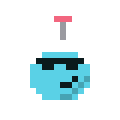
  <br />
  <sub>Made by <a href="https://github.com/YuvrajxGarg">PXLVZN</a>. VZN is an independent project and is not affiliated with Anthropic.</sub>
</p>
